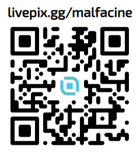

<p align="center">
  
</p>

# SIMNeo

O SIMNeo é um programa de videomonitoramento para Windows e Linux, escrito em Rust e
pensado para ser uma alternativa leve ao SIMNext, com uma interface simples para
acompanhar suas câmeras.

**Versão atual: 0.26.1 — Windows e Linux x86_64.**

Baixe os pacotes na página de [releases](https://github.com/malfacine/SIMNeo/releases/latest).

## O que você pode fazer

- Assistir às câmeras ao vivo em diferentes layouts, com qualidade SD ou HD.
- Cadastrar dispositivos por IP, serial ou ambos.
- Buscar e reproduzir gravações de uma câmera por vez.
- Controlar a reprodução em 1×, 2×, 4×, 8× e 16×, com buffer de vídeo.
- Exportar trechos em MP4, mantendo a resolução original da qualidade escolhida.
- Importar dispositivos de um ZIP exportado pelo SIM Next.
- Restaurar a última visualização.
- No Windows, iniciar com o sistema e usar aceleração de vídeo por GPU.

## Como usar

### Windows x64

1. Baixe `SIMNeo-0.26.1-windows-x64.zip` na página de releases.
2. Extraia todo o conteúdo para uma pasta.
3. Abra `SIMNeo.exe`.
4. Cadastre seu dispositivo e clique em uma câmera para abrir o vídeo.

Mantenha os arquivos do pacote juntos. Execute o programa diretamente da pasta extraída.

O ZIP inclui o runtime Visual C++ x64 necessário ao executável. Mantenha
`vcruntime140.dll` junto do `SIMNeo.exe`.

A interface usa renderização por software automaticamente quando o driver não
oferece OpenGL compatível. Isso é independente da aceleração de vídeo por GPU.

### Linux x86_64

Baixe `SIMNeo-0.26.1-linux-x86_64.AppImage`. Esta compilação exige **glibc 2.39
ou mais recente** e uma sessão gráfica Linux. Torne o arquivo executável e abra:

```sh
chmod +x SIMNeo-0.26.1-linux-x86_64.AppImage
./SIMNeo-0.26.1-linux-x86_64.AppImage
```

O AppImage inclui a biblioteca P2P nativa, FFmpeg, fontes, diálogos de arquivos
e o cliente do cofre. Para salvar e recuperar senhas, a sessão precisa de um
**Secret Service desbloqueado**, como GNOME Keyring, disponível pelo D-Bus.
O serviço do cofre é fornecido pelo sistema Linux.

Se o sistema não oferecer FUSE, execute com extração temporária:

```sh
./SIMNeo-0.26.1-linux-x86_64.AppImage --appimage-extract-and-run
```

No Linux, a interface usa renderização por software por padrão e o aplicativo
é iniciado manualmente, sem configuração de inicialização automática. No WSL2
com WSLg, a execução direta abre a janela no desktop do Windows. O runner de
testes usa Xvfb, por isso suas janelas não aparecem no desktop.

Consulte as [instruções do AppImage](native/linux/appimage/README.md) para
compilação, dependências e testes. O checksum SHA-256 e o manifesto das
bibliotecas acompanham o download na release.

### Cadastros e senhas

O banco fica em `%LOCALAPPDATA%\SimNEO\simneo.db` no Windows e em
`$XDG_DATA_HOME/simneo/simneo.db` no Linux, com fallback para
`$HOME/.local/share/simneo/simneo.db`.

As senhas do Windows usam DPAPI; no Linux, usam AES-256-GCM com a chave no cofre
da sessão. Ao transferir um banco do Windows para Linux, cadastre novamente as
senhas dos dispositivos. O banco Linux também depende da chave do cofre do
usuário: preserve ambos ao fazer backup. Os downloads não incluem cadastros
ou senhas de DVRs.

## Conexão com os dispositivos

Você pode usar o IP do dispositivo, o serial ou os dois. Quando ambos estão
cadastrados, o SIMNeo tenta o IP primeiro e usa o serial se essa conexão falhar.
O serial pode ser digitado em maiúsculas ou minúsculas; o programa ajusta automaticamente.

No Windows, os túneis por serial usam a DLL original do SIM Next, `libt2u.dll`,
localizada na pasta `assets`. No Linux, usam a biblioteca nativa
`libsim_t2u_linux.so`, incluída no AppImage, sem Wine ou DLL Windows.
As implementações de plataforma ficam separadas no código.

Os parâmetros do serviço
P2P são incorporados ao executável durante a compilação, sem arquivo de configuração
separado no pacote. Isso não impede sua extração por análise do executável.
Cadastros de dispositivos e senhas dos DVRs continuam sendo pessoais
e não acompanham o pacote.

## Sobre o projeto

O SIMNeo é um projeto independente e está em desenvolvimento. A versão 0.26.0
inicia sua distribuição pública, com foco em visualização ao vivo, reprodução
e exportação de gravações em dispositivos Intelbras/Dahua compatíveis.
O suporte Linux foi validado em um DVR real no Debian 13/WSL2, incluindo vídeo,
mosaico SD/HD, reprodução até 16× e exportação MP4. Outros dispositivos e
distribuições ainda precisam de validação.

## Apoie o projeto

Dar uma [estrela no GitHub](https://github.com/malfacine/SIMNeo) também ajuda a
apoiar o projeto e divulgar o SIMNeo.

Encontrou um problema? Relate pelo e-mail
[bugs@ashlight.app](mailto:bugs@ashlight.app), informando a versão do SIMNeo,
o sistema operacional e como reproduzir o erro. Não envie senhas ou credenciais.

Se quiser apoiar o desenvolvimento do SIMNeo, você pode fazer uma doação pelo LivePix.

[](https://livepix.gg/malfacine)

[Faça uma doação pelo LivePix](https://livepix.gg/malfacine)

## Licença

O código do SIMNeo é disponibilizado sob a licença **GNU AGPL-3.0**.
Consulte o arquivo [LICENSE](LICENSE).

A DLL original do SIM Next e as demais bibliotecas de terceiros mantêm suas
próprias licenças. Consulte [THIRD-PARTY.md](THIRD-PARTY.md).
